<p align="center">
  
</p>

# CineMáx

CineMáx es un proyecto con fines educativos que busca experimentar Laravel y Blade como un stack de desarrollo de aplicaciones web inspirado en un sitio web para cines.

## Stack

- PHP 8.3+ (la imagen Docker usa PHP 8.4)
- Laravel 13
- Vite 8 + Tailwind CSS 4
- MySQL 8.4
- PHPUnit 12 y Laravel Pint

## Requisitos

Para desarrollo local:

- [PHP 8.3+](https://www.php.net/downloads) con las extensiones `intl`, `pdo_mysql` y `zip`
- [Composer 2](https://getcomposer.org/download/)
- [Node.js 22+](https://nodejs.org/) y npm
- [MySQL 8](https://dev.mysql.com/downloads/) (o cambia `DB_CONNECTION=sqlite` en `.env`)

Para desarrollo con Docker solo necesitas [Docker](https://docs.docker.com/get-docker/) con Docker Compose.

## Uso local

### Linux

```bash
# Instalar dependencias (Debian/Ubuntu)
sudo apt install php php-cli php-intl php-mysql php-zip php-xml php-mbstring php-curl unzip composer nodejs npm

# Clonar e iniciar el proyecto
git clone <url-del-repositorio> mi-proyecto
cd mi-proyecto
cp .env.example .env    # edita DB_* con tus credenciales de MySQL
composer setup
composer dev
```

### macOS

```bash
# Instalar dependencias con Homebrew
brew install php composer node mysql
brew services start mysql

# Clonar e iniciar el proyecto
git clone <url-del-repositorio> mi-proyecto
cd mi-proyecto
cp .env.example .env    # edita DB_* con tus credenciales de MySQL
composer setup
composer dev
```

### Windows

Instala PHP, Composer, Node.js y MySQL. La forma más sencilla es con [Laravel Herd](https://herd.laravel.com/windows) o con `winget` desde PowerShell:

```powershell
winget install PHP.PHP.8.4 Composer.Composer OpenJS.NodeJS.LTS Oracle.MySQL
```

Luego, en PowerShell:

```powershell
git clone <url-del-repositorio> mi-proyecto
cd mi-proyecto
Copy-Item .env.example .env    # edita DB_* con tus credenciales de MySQL
composer setup
composer dev
```

> En Windows, asegúrate de habilitar las extensiones `intl`, `pdo_mysql` y `zip` en tu `php.ini`.

### ¿Qué hacen estos comandos?

- `composer setup`: instala dependencias PHP y npm, crea `.env` si no existe, genera `APP_KEY`, ejecuta las migraciones y compila los assets.
- `composer dev`: levanta el servidor de desarrollo con recarga en vivo.

La aplicación queda disponible en <http://localhost:8000>.

### Otros comandos útiles

```bash
composer test           # Ejecuta las pruebas
./vendor/bin/pint       # Formatea el código (en Windows: vendor\bin\pint)
php artisan migrate     # Ejecuta migraciones
```

## Uso con Docker

El entorno Docker está en `docker/` y levanta tres servicios:

| Servicio | Descripción                         | Puerto |
| -------- | ----------------------------------- | ------ |
| `app`    | Servidor Laravel (`artisan serve`)  | 8000   |
| `vite`   | Servidor de Vite con recarga en vivo | 5173   |
| `db`     | MySQL 8.4                           | 3306   |

Al iniciar, el contenedor `app` instala las dependencias de Composer, espera a la base de datos y ejecuta las migraciones. El contenedor `vite` instala las dependencias de npm. El código se monta como volumen, así que los cambios se reflejan al instante.

### 1. Configurar `.env`

Copia el archivo de ejemplo:

```bash
cp .env.example .env              # Linux / macOS
Copy-Item .env.example .env       # Windows (PowerShell)
```

Ajusta las variables de base de datos para que apunten al contenedor `db`:

```dotenv
DB_HOST=db
DB_PORT=3306
DB_DATABASE=cinemax
DB_USERNAME=cinemax
DB_PASSWORD=cinemax
```

Genera una `APP_KEY` y pégala en `.env`:

```bash
docker compose -f docker/compose.yaml run --rm --no-deps app php -r "echo 'base64:'.base64_encode(random_bytes(32)).PHP_EOL;"
```

### 2. Levantar el entorno

**Linux / macOS** (con [just](https://github.com/casey/just)):

```bash
just dev          # Construye y levanta app, vite y db
just dev-down     # Detiene el entorno
just dev-exec php artisan test    # Ejecuta un comando dentro del contenedor app
```

**Linux / macOS** (sin just):

```bash
UID=$(id -u) GID=$(id -g) docker compose -f docker/compose.yaml up --build
```

**Windows** (PowerShell):

```powershell
docker compose -f docker/compose.yaml up --build
```

Para detener el entorno en cualquier sistema:

```bash
docker compose -f docker/compose.yaml down
```

### 3. Ejecutar comandos dentro del contenedor

```bash
docker compose -f docker/compose.yaml exec app php artisan migrate
docker compose -f docker/compose.yaml exec app composer test
docker compose -f docker/compose.yaml exec app php artisan tinker
```

La aplicación queda disponible en <http://localhost:8000>.

> Si cambias valores en `.env`, recrea el contenedor para que los tome:
> `docker compose -f docker/compose.yaml up -d --force-recreate app`

### Development Kit Container (opcional)

El `Justfile` incluye `just dkc`, que abre una shell interactiva en la imagen `ghcr.io/leoborai/dkc:latest` con el proyecto montado en `/app`.

## Entidades

El siguiente esquema representa las entidades usadas en este proyecto.

```mermaid
erDiagram
    users ||--o{ sessions : "has"
    users ||--o{ purchases : "makes"
    rooms ||--o{ seats : "has"
    rooms ||--o{ screenings : "hosts"
    movies ||--o{ screenings : "is shown in"
    purchases ||--o{ payments : "paid by"
    purchases ||--o{ tickets : "contains"
    screenings ||--o{ tickets : "admits"
    seats ||--o{ tickets : "reserved by"

    users {
        bigint id PK
        varchar(255) name
        varchar(255) email UK
        timestamp email_verified_at "nullable"
        varchar(255) password
        varchar(20) role "customer, admin (default customer); indexed"
        varchar(100) remember_token "nullable"
        timestamp created_at "nullable"
        timestamp updated_at "nullable"
    }

    password_reset_tokens {
        varchar(255) email PK
        varchar(255) token
        timestamp created_at "nullable"
    }

    sessions {
        varchar(255) id PK
        bigint user_id FK "nullable; indexed"
        varchar(45) ip_address "nullable"
        text user_agent "nullable"
        longtext payload
        int last_activity "indexed"
    }

    cache {
        varchar(255) key PK
        mediumtext value
        bigint expiration "indexed"
    }

    cache_locks {
        varchar(255) key PK
        varchar(255) owner
        bigint expiration "indexed"
    }

    jobs {
        bigint id PK
        varchar(255) queue "indexed"
        longtext payload
        smallint attempts
        int reserved_at "nullable"
        int available_at
        int created_at
    }

    job_batches {
        varchar(255) id PK
        varchar(255) name
        int total_jobs
        int pending_jobs
        int failed_jobs
        longtext failed_job_ids
        mediumtext options "nullable"
        int cancelled_at "nullable"
        int created_at
        int finished_at "nullable"
    }

    failed_jobs {
        bigint id PK
        varchar(255) uuid UK
        varchar(255) connection
        varchar(255) queue
        longtext payload
        longtext exception
        timestamp failed_at
    }

    movies {
        bigint id PK
        varchar(200) title "indexed"
        text description
        smallint duration_minutes
        varchar(100) genre "nullable"
        varchar(500) poster_url "nullable"
        timestamp created_at "nullable"
        timestamp updated_at "nullable"
    }

    rooms {
        bigint id PK
        varchar(50) name UK
        tinyint row_count
        tinyint seats_per_row
        timestamp created_at "nullable"
        timestamp updated_at "nullable"
    }

    seats {
        bigint id PK
        bigint room_id FK "indexed; UNIQUE with row_label, seat_number"
        varchar(5) row_label
        tinyint seat_number
        timestamp created_at "nullable"
        timestamp updated_at "nullable"
    }

    screenings {
        bigint id PK
        bigint movie_id FK "indexed"
        bigint room_id FK "indexed"
        datetime starts_at "indexed"
        decimal price "decimal(8,2)"
        timestamp created_at "nullable"
        timestamp updated_at "nullable"
    }

    purchases {
        bigint id PK
        bigint user_id FK "indexed"
        varchar(20) status "pending, paid, cancelled; indexed"
        decimal total_amount "decimal(8,2)"
        timestamp created_at "nullable"
        timestamp updated_at "nullable"
    }

    payments {
        bigint id PK
        bigint purchase_id FK "indexed"
        varchar(100) provider_reference UK
        decimal amount "decimal(8,2)"
        timestamp paid_at "nullable"
        timestamp created_at "nullable"
        timestamp updated_at "nullable"
    }

    tickets {
        bigint id PK
        bigint purchase_id FK "indexed"
        bigint screening_id FK "indexed; UNIQUE with seat_id"
        bigint seat_id FK "indexed"
        varchar(20) status "active, used; indexed"
        decimal price "decimal(8,2)"
        timestamp created_at "nullable"
        timestamp updated_at "nullable"
    }
```



## Licencia

Proyecto de código abierto bajo la [licencia MIT](LICENSE).
